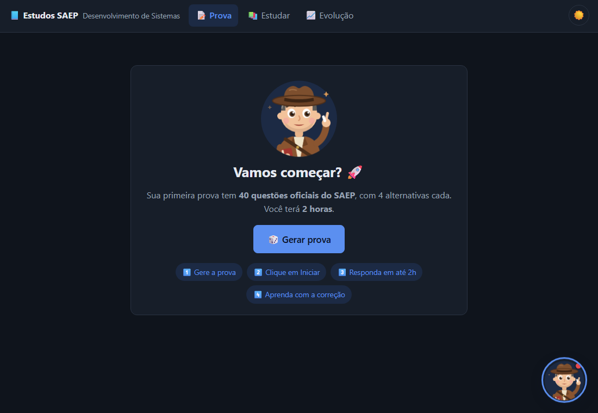
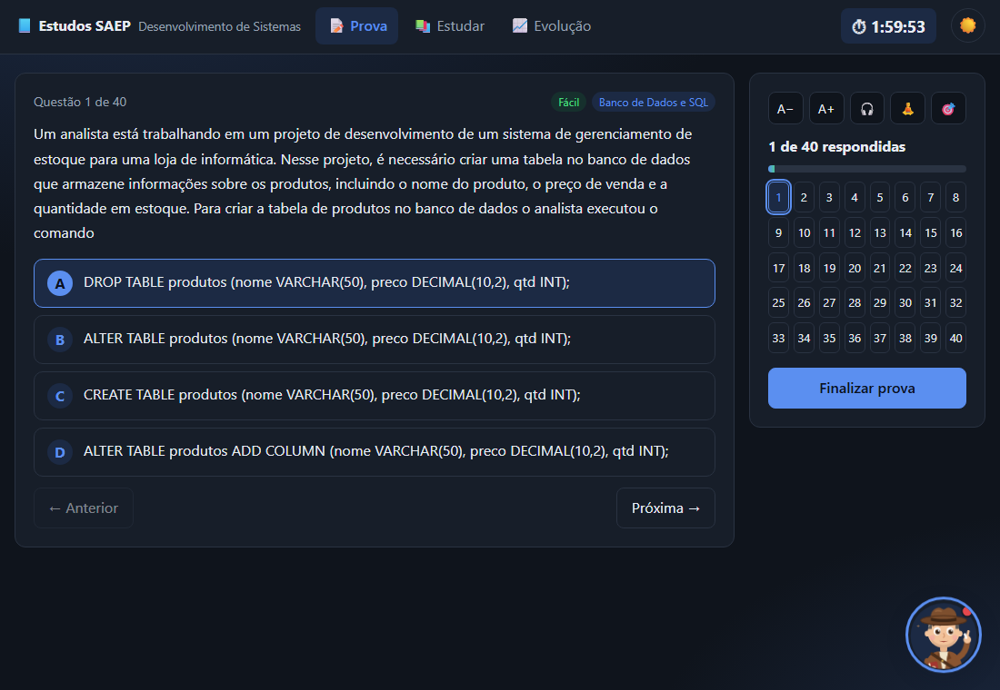
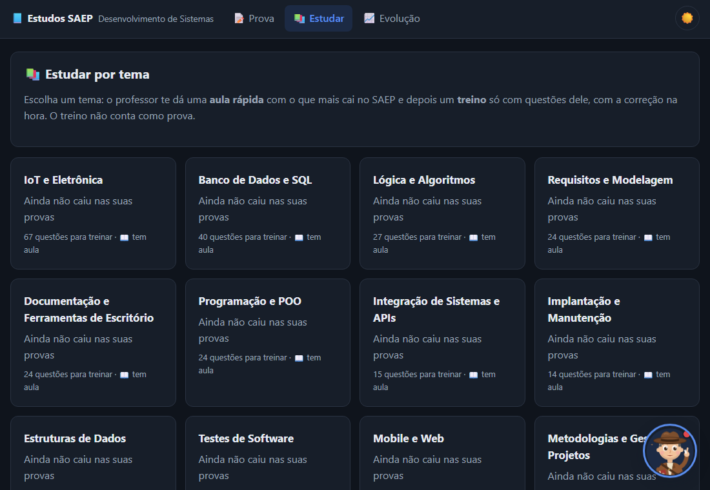

# 📱 Estudos SAEP — App Android

App de estudos para a **prova SAEP do SENAI** (Técnico em Desenvolvimento de Sistemas), criado por [Natã Baracho](https://www.linkedin.com/in/nat%C3%A3-baracho-7a997934a/) e usado para treinar alunos do SENAI.
Funciona **100% offline**: questões, explicações e aulas já vêm dentro do app.

[](https://github.com/NatBaracho/estudos-saep-android/releases/latest/download/EstudosSAEP.apk)
[](https://www.estudossaep.workers.dev)


<p align="center">
  
  
  
</p>

## 💡 Sobre o projeto

O **Estudos SAEP** é um sistema que eu desenvolvi em três formatos, todos com as mesmas regras e o mesmo conteúdo:

| Formato | Tecnologia |
|---|---|
| 💻 **PC (Windows)** | C# / ASP.NET Core + SQLite, empacotado em um único `.exe` |
| 🌐 **Web** | Cloudflare Workers + banco D1, com progresso salvo na nuvem → [estudossaep.workers.dev](https://www.estudossaep.workers.dev) |
| 📱 **Android** (este repositório) | Capacitor 8, APK gerado e assinado pelo GitHub Actions |

**Destaques técnicos deste app:**

- **Mesma tela do PC, sem servidor:** a interface chama `fetch("/api/...")` como no sistema do PC. No celular, o [`fonte/local-api.js`](fonte/local-api.js) intercepta essas chamadas e responde com as mesmas regras do servidor C#, guardando o progresso no aparelho.
- **Regras de montagem das provas** reimplementadas em JavaScript: sem repetir questões, reforço das que o aluno errou e níveis alternados.
- **CI/CD:** a cada push na `main`, o GitHub Actions cria o projeto Android, gera os ícones, compila, **assina** o APK (chave guardada nos *secrets*) e publica em [Releases](https://github.com/NatBaracho/estudos-saep-android/releases).
- **Conteúdo exportado automaticamente** do sistema principal por um script em Python, então PC, web e celular ficam sempre iguais.

> O código do sistema do PC e do site fica em repositórios privados. Este repositório mostra o app Android completo.

## ✨ O que o app faz

- 📝 **Provas de 40 questões** no estilo SAEP, com cronômetro de 2 horas.
- 🎯 **Nota de 0 a 10**, com média **7,5** para aprovação.
- 🆕 **Sem repetir questões:** cada prova traz só questões que você ainda não viu.
- 🔁 **Reforço a cada 3 provas:** a prova seguinte traz 4 questões (10%) das 3 anteriores, primeiro as que você errou.
- 📚 **Todos os assuntos** em toda prova e 🎚️ **níveis alternados** (fácil, moderado, difícil e muito difícil), com etiqueta colorida em cada questão.
- 🏆 **Seus destaques:** o tema em que você foi melhor e o que precisa reforçar.
- 📚 **Estudar por tema:** aula do professor + treino de 10 questões com correção na hora.
- 📈 **Evolução:** nota média, melhor nota e acerto por tema.
- 🧑‍🏫 **Professor animado** com dicas e incentivo, além de recursos de conforto na prova (letra maior, som ambiente, pausa para respirar).

## 📲 Como instalar no celular

**Guia completo, com o que fazer em cada aviso e o caminho por marca de celular: [INSTALAR_NO_CELULAR.md](INSTALAR_NO_CELULAR.md)**

1. No celular, toque em [**⬇️ EstudosSAEP.apk**](https://github.com/NatBaracho/estudos-saep-android/releases/latest/download/EstudosSAEP.apk) para baixar a versão mais nova.
2. Abra o arquivo baixado. Se o Android pedir, permita **"Instalar apps desconhecidos"** para o navegador ou para o app de arquivos.
3. Pronto: o ícone do professor aparece na tela inicial.

**Para atualizar:** baixe o APK novo e instale **por cima**. Seu progresso continua salvo.

> ⚠️ O progresso fica guardado **no celular**. Desinstalar o app ou limpar os dados dele apaga as provas feitas.

## 🛠️ Como funciona (para quem programa)

```
Sistema principal (PC, privado)                 estudos-saep-android (este)
SistemaSAEP/wwwroot  ── tela ─────────────────▶ www/  (cópia da tela)
SistemaSAEP/Data     ── questões e aulas ─────▶ www/dados.js
tools/exportar_app.py  (faz a cópia)            fonte/local-api.js  (faz o papel do servidor)
                                                fonte/mobile.css    (ajustes para celular)
```

| Pasta / arquivo | O que é |
|---|---|
| `www/` | Tela do app (HTML, CSS e JavaScript) e o conteúdo (`dados.js`) |
| `fonte/local-api.js` | "Servidor" local: responde às rotas `/api/...` com as regras das provas |
| `fonte/mobile.css` | Ajustes de layout para celular |
| `.github/workflows/apk.yml` | Pipeline que gera, assina e publica o APK |
| `recursos/` | Script que gera o ícone do app |
| `docs/prints/` | Imagens das telas usadas neste README |

A pasta `android/` não fica no repositório: o GitHub Actions cria o projeto a cada build.

### Testar no PC

```bash
python -m http.server 5099 --directory www
```

Depois abra http://localhost:5099 no navegador (use o modo celular do DevTools).

### Assinatura do APK

O APK é assinado com uma chave guardada nos *secrets* do repositório (`KEYSTORE_BASE64` e `KEYSTORE_SENHA`).
Uma cópia fica no PC do autor, fora do git. Sem ela, a próxima versão não instala por cima e o usuário perderia o progresso.

## 👤 Autor

**Natã Baracho** — estudante de Engenharia de Software (Anhanguera) e do Técnico em Desenvolvimento de Sistemas (SENAI Juazeiro do Norte).
[LinkedIn](https://www.linkedin.com/in/nat%C3%A3-baracho-7a997934a/)
